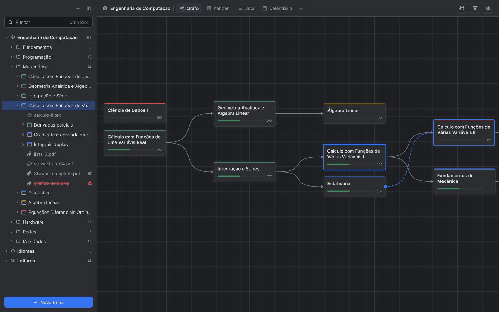
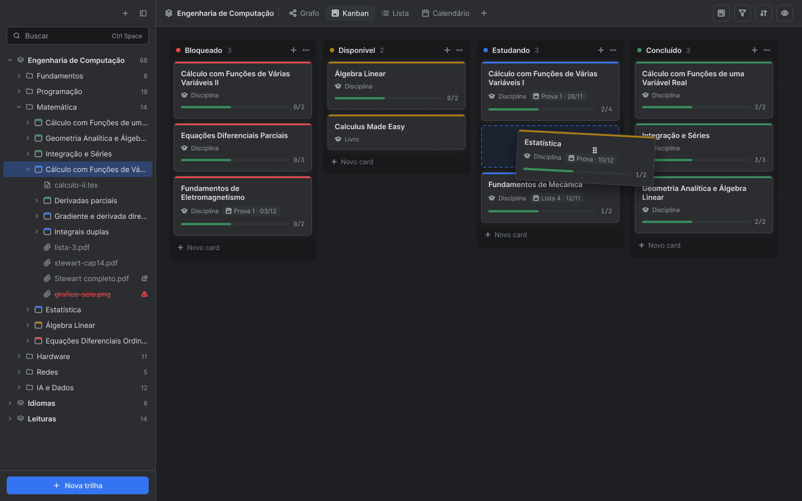
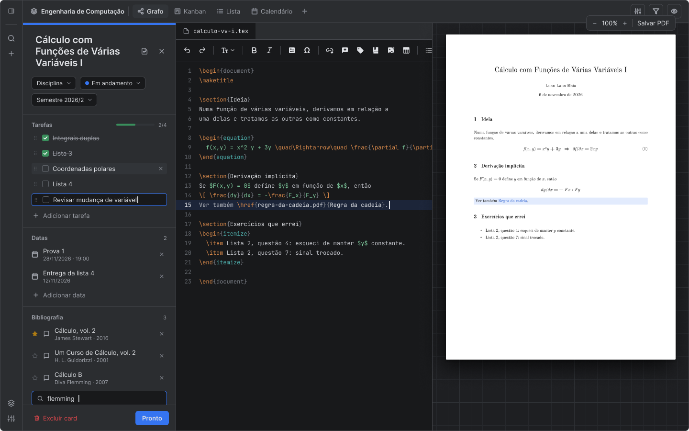
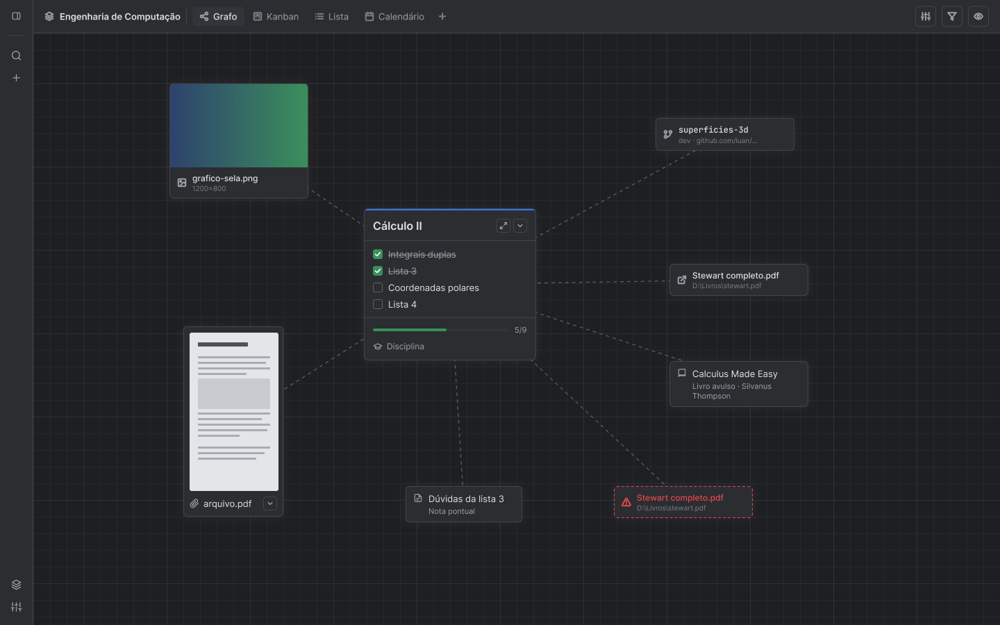
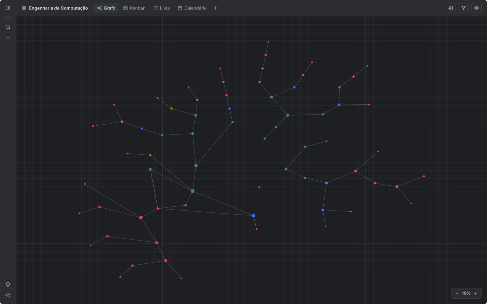
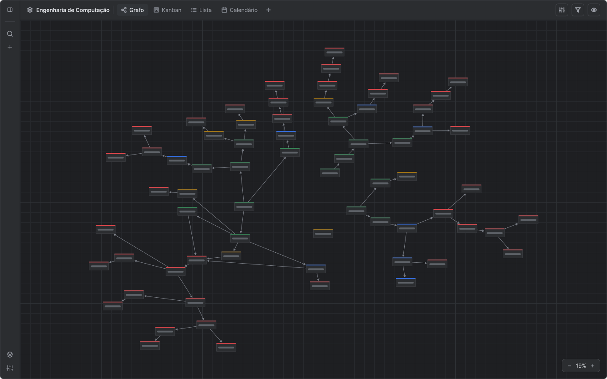
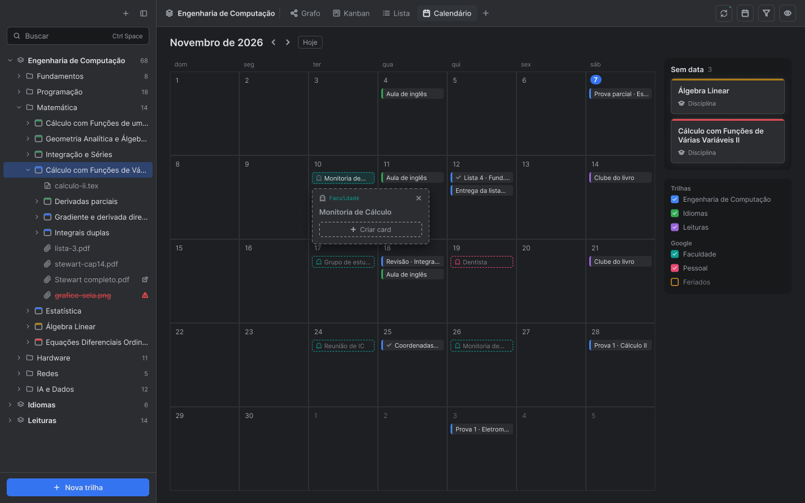

# SecondBrain

> Nome provisório. Projeto em fase de **planejamento**.

Um aplicativo de notas no estilo de um vault, um second brain: guarda o que você já sabe e organiza o que vem depois. As notas ficam num **grafo de cards** espalhados num espaço infinito, ligados por **links** e por **dependências**, e agrupados em **grafos** independentes. Com funcionalidades acompanham o fluxo de quem estuda, pesquisa e desenvolve.

Cada card é a miniaturização de uma nota em **Markdown** ou **LaTeX**, à sua escolha: linguagens de marcação simples, que dão para escrever rápido e abrem fora do app. Cada card também pode ter a seu próprio **grafo interna**, com cards menores, arquivos e notas.

---

## Telas

<sub>Protótipos do Figma; a interface atual do app ainda é provisória.</sub>

**Grafo: criar conexão arrastando**



**Kanban agrupado por estado**



**Edição do card com a nota (duplo clique)**



**Grafo com o explorador recolhido**



**Disposição radial em bolinhas**



**Disposição radial afastada (miniaturas)**



**Calendário com evento do Google**



---

## A ideia em uma imagem

```
Trilha "Engenharia de Computação"

  [Cálculo I] ──► [Integração e Séries] ──► [Várias Variáveis I] ──► [Várias Variáveis II] ──► [EDO]
                          │                          │
                          └──► [Estatística]         └──► [Fundamentos de Mecânica] ──► [OFT]
                                    ┊
                                    ┊ (link)
                                    ┊
                             (O Andar do Bêbado)

Trilha "Idiomas"

  [Línguas] ──► [Francês] ──► [A1] ──► [A2] ──► [B1] ...
            └─► [Inglês]  ──► [A1] ──► [A2] ──► [B1] ...
```

- **Setas contínuas:** dependências. Ordena os cards para estruturar um plano de estudo, pesquisa ou de projeto. 
- **Linha pontilhada:** link, para navegar de uma nota a outra.
- **Disposição:** a imagem mostra a auto-organização horizontal, em que cada card fica à direita do que vem antes dele. O grafo também pode ser arrumado em outros arranjos, como uma grafo circular ao redor de um card.
- **Cor da faixa no topo do card:** um estado ou propriedade do card..

---

## Princípios

1. **O grafo é a tela principal.** As notas são cards num espaço infinito.
2. **Um card é uma nota.** O card do grafo é uma miniatura da nota completa.
3. **Dependência é estrutura.** As conexões definem a ordem e permitem uma espécie de gameficação do aprendizado.
4. **Menos é mais, mais é mais.** O zoom semântico decide o que aparece em cada nível. Zoom-out mostra mais cards com menos detalhes e ao dar zoom em um card é possível visualizar mais informações e metadados.
5. **Os arquivos são seus.** As notas são `.md` ou `.tex`, sem sintaxe nem pacote próprios, e funcionam em qualquer editor ou distribuição LaTeX. 

---

## Conceitos

| Termo             | O que é                                                                                                                                                                   |
| ----------------- | ------------------------------------------------------------------------------------------------------------------------------------------------------------------------- |
| **Trilha**        | Um grafo de cards independentes, como "Matérias da Engenharia de Computação", "Idiomas" ou "Leituras".                                                                    |
| **Card**          | Uma nota no grafo. Tem título, estado, e propriedades: como tarefas e progresso.                                                                                          |
| **Tipo de card**  | Preset inicial criado pelo usuário: nome e ícone compartilhados, mais as propriedades que o card recebe ao ser criado.                                                                                                     |
| **Propriedades**  | Campos personalizados do card. Alguns já vêm prontos, como:  tarefas, progresso, bibliografia, vídeos e relacionados.                                                     |
| **Grafo interno** | O grafo de dentro de um card, como os assuntos de Cálculo II. Usa os mesmos cards, de forma recursiva.                                                                    |
| **Nota**          | O texto do card, um arquivo `.md` ou `.tex`.                                                                                                                              |
| **Conexão**       | Ordem, precedência e dependência entre cards. Linha contínua com seta.                                                                                                    |
| **Link**          | Um link entre notas e elementos do grafo, para navegar entre eles. Linha tracejada.                                                                                       |
| **Nota pontual**  | Uma nota pequena e simples, (um livro avulso, um artigo, um PDF), que fica perto de um card e só aparece quando você se aproxima dele.                                    |
| **Nota fantasma** | Uma sugestão de novo card que aparece, translucida e com contorno tracejado, ao lado de um card com elementos especiais (`\section`, `\chapter` ou um título em Markdown) |

---

## Estado do card

O estado aparece numa **faixa colorida no topo do card**, sem rótulo de texto.
É possivel criar estados personalizados, escolher uma cor RGB ou Hexadecimal para o estado.

Exemplos:

| Cor      | Estado       |
| -------- | ------------ |
| Azul     | Em andamento |
| Amarelo  | Disponível   |
| Vermelho | Bloqueado    |
| Verde    | Concluído    |

---

## Documentação

| Documento                                    | Conteúdo                                                                                      |
| -------------------------------------------- | --------------------------------------------------------------------------------------------- |
| [Grafo e conexões](docs/grafo-e-conexoes.md) | Trilhas, conexões, dependências, zoom semântico, auto-organização e bolinhas                  |
| [Cards e notas](docs/cards-e-notas.md)       | Tipos de card, estrutura, grafo, arquivos, notas pontuais, notas fantasmas e o editor do card |
| [LaTeX](docs/latex.md)                       | Formato das notas, leitura, edição e compilação                                               |
| [Interface](docs/interface.md)               | Telas desenhadas no Figma, uma por uma                                                        |
| [Stack](docs/stack.md)                       | Java 25, JavaFX e Maven: versões, como rodar e os pacotes do código                           |
