# Modelagem do SecondBrain (rascunho)

> Rascunho para discussão, de 07/11/2026. Os diagramas são Mermaid, que o GitHub e o Obsidian desenham sozinhos.

## Modelos adotados

| Modelo | Seção | Para que serve |
|---|---|---|
| **Casos de uso** | 1 | Lista o que o usuário faz no app. Vira o escopo da v1 e o checklist de funcionalidades. |
| **Modelo de domínio** | 2.1, 2.2, 2.4, 2.5 | Fixa os conceitos (trilha, card, nota, conexão, link, propriedade, tipo, arquivo, repositório, livro), as cardinalidades e como tudo aparece no disco. |
| **Visualizações e filtros** | 2.3 | Separa os dados (trilha, cards, propriedades) da forma de ver (grafo, kanban, lista, calendário). É o que deixa o app ganhar visualizações novas sem mexer no modelo. |
| **Diagrama de estados do card** | 3 | Mostra quando o app atualiza o estado sozinho (dependências concluídas, 100%) e deixa claro que o usuário sempre pode trocar. |
| **Diagramas de sequência** | 4 | Fluxos com mais de uma parte trabalhando: compilar a nota em segundo plano, compor um documento a partir de vários cards, link automático pela referência e arrastar um card para o calendário. Outros entram aqui quando forem precisos. |
| **Funcionalidades das telas** | 5 | Cada interação das telas do Figma (Telas v2) e o que ela faz nos dados. É o que garante que nenhuma tela tem um comportamento sem especificação. |
| **Sincronização com o Google Calendar** | 6 | Regras de ida e volta das datas, conflitos e as notas fantasmas que os eventos geram. |

**Fora do escopo** (decidido em 07/11/2026): diagrama de classes de projeto (o código), ER físico e diagramas de componentes, implantação e atividades.

---

## 1. Casos de uso

O Mermaid não tem diagrama de casos de uso, então vai como fluxograma: o ator à esquerda, os casos agrupados por área.

```mermaid
flowchart LR
    U(["👤 Usuário"])
    TEX(["⚙️ Compilador LaTeX"])
    FS(["📁 Sistema de arquivos"])
    WEB(["🌐 Busca de livros<br/>(ISBN / DOI)"])
    GCAL(["📅 Google Calendar"])

    subgraph Trilhas
        UC41([Escolher o acervo na primeira abertura])
        UC64([Retomar pela tela inicial])
        UC1([Criar trilha])
        UC2([Navegar pelo explorador])
        UC42([Recolher o explorador])
        UC3([Abrir trilha no espaço infinito])
        UC43([Abrir qualquer coisa pela troca rápida])
        UC44([Rodar uma ação pela paleta de comandos])
    end

    subgraph Visualizações
        UC4([Criar card])
        UC6([Criar conexão de dependência])
        UC7([Criar link])
        UC53([Soltar um elemento num card: link manual])
        UC8([Escolher visualização: grafo, kanban, lista...])
        UC34([Escolher disposição do grafo])
        UC9([Dar zoom semântico])
        UC10([Escolher fundo])
        UC11([Filtrar])
        UC63([Ordenar os cards do kanban])
        UC39([Montar filtro com regras])
        UC40([Salvar visualização com os filtros])
        UC35([Arrastar card entre colunas do kanban])
        UC36([Arrastar card ou data para um dia do calendário])
        UC45([Criar visualização numa aba nova])
        UC46([Agrupar o kanban por uma seleção])
        UC47([Escolher as colunas da lista])
        UC48([Ver o calendário em mês ou semana])
        UC49([Buscar no grafo])
        UC50([Ver a prévia do PDF do card])
        UC51([Expandir card])
    end

    subgraph Cards
        UC12([Editar card no editor do card])
        UC13([Escolher tipo e estado])
        UC14([Gerenciar propriedades])
        UC15([Marcar tarefa])
        UC16([Abrir grafo interno])
        UC17([Transformar nota fantasma em card])
        UC54([Recusar nota fantasma])
        UC52([Adicionar arquivo: mover ou só o caminho])
    end

    subgraph Notas
        UC19([Ler nota como PDF])
        UC58([Ler arquivo .epub])
        UC57([Clique duplo no PDF: abrir o .tex no mesmo ponto])
        UC20([Editar nota .md ou .tex])
        UC56([Escrever uma referência na nota: link automático])
        UC21([Compilar nota])
        UC22([Compor documento a partir de vários cards])
        UC37([Selecionar os cards: caminho ou seleção livre])
        UC38([Ordenar as partes])
    end

    subgraph Bibliografia
        UC23([Buscar e adicionar livro])
        UC24([Escolher livros do card])
    end

    subgraph Calendário externo
        UC59([Conectar a conta do Google])
        UC60([Exportar as datas para o Google Calendar])
        UC61([Importar eventos do Google Calendar])
        UC62([Transformar evento importado em card])
    end

    subgraph Configurações
        UC18([Criar e editar tipos de card])
        UC25([Criar e editar estados])
        UC26([Escolher a pasta do acervo])
        UC27([Definir formato padrão da nota])
        UC28([Definir autor padrão das notas])
        UC29([Escolher o compilador LaTeX])
        UC30([Ajustar a compilação automática])
        UC31([Escolher visualização padrão])
        UC32([Escolher tema])
        UC33([Editar atalhos de teclado])
        UC55([Religar propriedades órfãs])
    end

    U --- UC64 & UC41 & UC1 & UC2 & UC42 & UC3 & UC43 & UC44
    U --- UC4 & UC6 & UC7 & UC8 & UC34 & UC9 & UC10 & UC11 & UC39 & UC40 & UC35 & UC36
    U --- UC63 & UC45 & UC46 & UC47 & UC48 & UC49 & UC50 & UC51
    UC35 -. muda o valor da propriedade .-> UC13
    UC36 -. atribui uma data .-> UC14
    UC11 -. inclui .-> UC39
    UC7 -. inclui .-> UC53
    UC7 -. inclui .-> UC56
    UC49 -. leva a .-> UC53
    UC41 -. é o mesmo que .-> UC26
    U --- UC12 & UC13 & UC14 & UC15 & UC16 & UC17 & UC54 & UC52
    U --- UC19 & UC20 & UC22 & UC56 & UC57 & UC58
    UC57 -. leva a .-> UC20
    U --- UC23 & UC24
    U --- UC18 & UC25 & UC26 & UC27 & UC28 & UC29 & UC30 & UC31 & UC32 & UC33 & UC55
    UC41 --- FS
    UC52 --- FS

    UC20 -. inclui .-> UC21
    UC22 -. inclui .-> UC21
    UC22 -. inclui .-> UC37
    UC22 -. inclui .-> UC38
    UC21 --- TEX
    UC20 --- FS
    UC23 --- WEB
    U --- UC59 & UC60 & UC61 & UC62
    UC60 --- GCAL
    UC61 --- GCAL
    UC61 -. gera notas fantasmas .-> UC62
    UC62 -. como .-> UC17
    UC29 --- TEX
```

### O que cabe nas configurações

| Configuração | O que o usuário faz | Origem |
|---|---|---|
| **Tipos de card** | Cria, edita e apaga tipos: nome, ícone e propriedades iniciais. Editar vale só para cards novos. | `cards-e-notas.md` |
| **Estados** | Cria estados com nome e cor (RGB ou hexadecimal), cada um numa das quatro categorias. Servem de colunas no kanban. | README, decidido em 07/11 |
| **Pasta do acervo** | Escolhe onde ficam as trilhas, notas e arquivos no disco. Na primeira abertura o app pede a pasta (criar uma nova ou abrir uma existente). | Telas v2 |
| **Propriedades órfãs** | Lista as propriedades de notas renomeadas ou movidas com o app fechado, para religar a uma nota. Nunca são apagadas sozinhas. | Telas v2, seção 2.5 |
| **Formato padrão da nota** | `.md` ou `.tex` para os cards novos. Cada card pode mudar. | Proposta, a partir de "à sua escolha" no README |
| **Autor padrão** | O nome que vai no `\author` das notas LaTeX. | `latex.md` |
| **Compilador LaTeX** | Usa o Tectonic embutido ou o TeX instalado na máquina. | Conversa de 07/11 |
| **Compilação automática** | Liga ou desliga, e ajusta a espera depois de parar de digitar (padrão ~1 s). | `latex.md` |
| **Visualização padrão** | Com que visualização uma trilha nova abre (grafo, kanban, lista, calendário), e no grafo a disposição, o fundo, mostrar links, mostrar conexões e os concluídos (normais, apagados ou ocultos). Cada trilha pode mudar. | Telas v2 |
| **Tema** | Escuro por enquanto. Outros temas ficam para o futuro. | Proposta |
| **Atalhos** | Ctrl Space (troca rápida), Ctrl P (paleta de comandos) e os do editor. Clicar numa tecla grava a combinação nova; conflitos aparecem marcados. | Telas v2, inspirada no Obsidian |

---

## 2. Modelo de domínio

Conceitos e relações, sem detalhes de tela nem de armazenamento. Está dividido em três diagramas: o núcleo (trilha, card, nota e propriedades), os elementos da trilha (cards, arquivos, repositórios e livros) e as visualizações.

**Princípio:** o modelo guarda só os dados e as relações. Nada nele sabe como vai ser desenhado. Posição, coluna, linha e cor na tela são da visualização, calculadas a partir dos dados. Assim o mesmo conjunto de cards aparece como grafo, kanban, lista ou calendário.

### 2.1 Núcleo

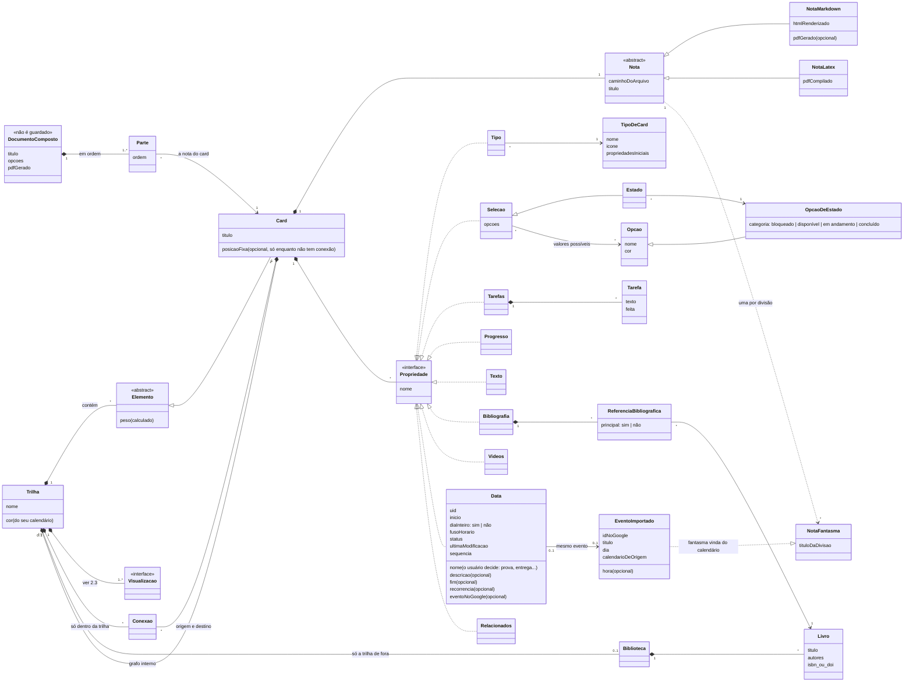

### 2.2 Elementos da trilha: arquivos, imagens, PDFs, repositórios e livros

Tudo o que pertence a uma trilha é um **Elemento**. Só cards têm conexões (dependência). Qualquer elemento pode ter links.

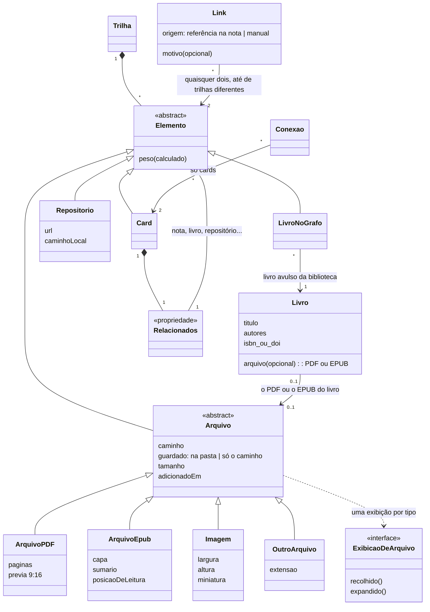

**O que os diagramas não mostram sozinhos:**

- **Nada é regra, tudo é informação.** Estado, conexão e progresso servem para visualizar e organizar. Nenhum deles impede o usuário de abrir, editar ou mudar um card.

- Uma conexão só liga **cards** da **mesma trilha**, e **não pode formar ciclo**: o app recusa a conexão que fecharia um ciclo (D-52).
- Um **link** liga quaisquer dois elementos: card com card, card com PDF, card com repositório, livro com card. Um link **pode ligar trilhas diferentes** (ao contrário da conexão), por isso ele não pertence a uma trilha só.
- **Um link nasce de dois jeitos.** **Automático:** a nota tem uma referência (o comando próprio `\nota{slug}{texto}` no `.tex`, trocado por `\href` quando o arquivo é usado fora do app; `[[…]]` no `.md`). Se o nome existe em mais de uma trilha, o app pergunta qual é ao criar e grava o caminho. Esse link é lido do texto, como a nota fantasma, e não é guardado: apagar a referência apaga o link. **Manual:** o usuário solta um elemento num card (ou usa "Vincular" no editor). Esse fica no arquivo do card em `.secondbrain/` e não aparece no texto da nota.
- **Arquivos, imagens, PDFs, repositórios e livros avulsos** ficam no espaço da trilha (ou no grafo interno de um card) como elementos de peso baixo: só aparecem no zoom próximo, ligados por links.
- **Relacionados** é a propriedade do card que lista elementos ligados a ele sem fazer parte dele. É a versão em lista do que os links mostram no grafo.
- Cada tipo de arquivo tem **a sua exibição** (Strategy): o PDF é um card comprido com prévia 9:16, a imagem mostra a miniatura, os outros mostram ícone e nome. Um tipo novo é só uma exibição nova.
- **EPUB** é lido no próprio app. No grafo aparece como o PDF, num card comprido 9:16, mas com a **capa** no lugar da primeira página; expandido mostra autor, capítulos, tamanho e o quanto já foi lido. Ao contrário do PDF, o texto do EPUB **reflui**: não tem página fixa, então o leitor navega por capítulo (sumário) e guarda a **posição de leitura** do usuário, que volta ao abrir de novo. Um livro da biblioteca pode ter um EPUB no lugar do PDF.
- A **biblioteca** é da trilha de fora. Os cards do grafo interno (em qualquer nível) usam a biblioteca da trilha em que estão inseridos, sem ter uma própria.
- O **livro** existe uma vez só, na biblioteca da trilha. No grafo aparece como livro avulso (LivroNoGrafo), e nos cards como referência bibliográfica.
- **Tipo e estado são propriedades**, como tarefas ou bibliografia. O valor da propriedade Tipo aponta para um TipoDeCard (nome e ícone), e o da propriedade Estado aponta para uma das opções de estado (nome e cor).
- O tipo é só um preset: as propriedades são **copiadas** na criação. Por isso TipoDeCard só guarda a lista inicial, e o card fica com as suas.
- **Estado é uma seleção**: uma propriedade cujo valor é uma das opções de uma lista, cada opção com nome e cor. O usuário cria os estados que quiser, e cada estado pertence a uma das quatro **categorias** (bloqueado, disponível, em andamento, concluído). As indicações automáticas olham a categoria, não o nome, por isso continuam valendo com estados personalizados.
- O usuário pode criar **outras seleções** além do estado (prioridade, semestre, área...). Qualquer seleção pode virar as colunas de um kanban.
- O usuário **não move cards no grafo**: a posição é calculada pelo algoritmo de disposição. No kanban, arrastar um card de coluna muda o valor da propriedade, e não uma posição.
- **Card solto fica onde foi criado** (decidido em 07/11/2026). Criar um card num ponto do espaço é a única vez em que o usuário escolhe uma posição: o card fica **fixo** ali enquanto não tiver nenhuma conexão (dependência). Enquanto está fixo, ele **repele** os cards em volta, que se afastam numa animação que parece magnética, para não ficar nada por baixo dele. Quando ganha a primeira conexão com outro card, perde a posição fixa e passa a ser arrumado pela disposição junto com os outros. Link não solta o card; só conexão. A posição fixa fica no arquivo do card, em `.secondbrain/cards/<id>`, e é apagada quando a conexão chega. Se depois o card perder todas as conexões, ele continua onde a disposição o deixou e não volta a ficar fixo (proposta).
- **Pasta = grafo interno.** Uma nota pode ter, ao lado, uma pasta com o mesmo nome. Essa pasta é o grafo interno do card: guarda as notas internas e os arquivos ligados a elas. Card sem pasta não tem grafo interno (e não mostra o botão maximizar). Ver a seção 2.4.
- **Pasta comum = agrupamento** (decidido em 07/11/2026). Uma pasta da trilha que não tem nota de mesmo nome (Fundamentos, Matemática) não é card nem grafo interno: ela **agrupa** os seus cards no grafo, como um cluster. A disposição continua calculando as posições e procura manter os cards da mesma pasta juntos; o grupo aparece como uma área suave atrás deles, com o nome da pasta (proposta). O usuário pode desligar o agrupamento na visualização (`Grafo.agruparPorPasta`).
- **Peso vem das propriedades.** Quanto mais propriedades um card tem, mais forte ele é no grafo. Uma **nota pontual** não é um tipo à parte: é um card sem propriedade especial, só texto ou uma anotação. Por ter peso baixo, some nas visões afastadas (macro) e só aparece no zoom próximo, perto do card ligado a ela que está em foco. Se ela está ligada a vários cards, aparece junto de cada um quando o zoom foca nele. A posição dela não é fixa no grafo: é relativa ao card em foco.
- **Documento composto (decidido em 07/11/2026):** é **só um PDF**, gerado juntando o LaTeX dos cards selecionados (um caminho de conexões ou uma seleção livre), na ordem escolhida: um resumo para a prova, um relatório, o TCC. **Não é um card**, não aparece no grafo e não tem propriedades. O `.tex` que junta as partes (um `\input` por nota) é temporário: o app compila, mostra o PDF e o usuário salva onde quiser. Para gerar de novo com as notas atualizadas, compõe outra vez.
- **Notas `.md` no documento composto:** no futuro haverá um **tradutor de LaTeX para Markdown e de volta** (D-26), e aí cada nota `.md` da seleção é traduzida para LaTeX antes do `\input`, num arquivo temporário; a nota original não muda. Até o tradutor existir, a composição junta só as notas `.tex`, e os cards `.md` do caminho aparecem marcados como "fica de fora" no painel (proposta).
- O progresso é derivado: tarefas concluídas + cards concluídos do grafo interno.
- A nota fantasma não é guardada: é calculada a partir das `\section`, `\chapter` ou títulos `#` da nota.

### 2.3 Visualizações

Uma trilha tem uma ou mais visualizações salvas. Cada uma lê os mesmos elementos, filtra e desenha do seu jeito. Uma visualização nova é só mais uma implementação, sem mexer no modelo.

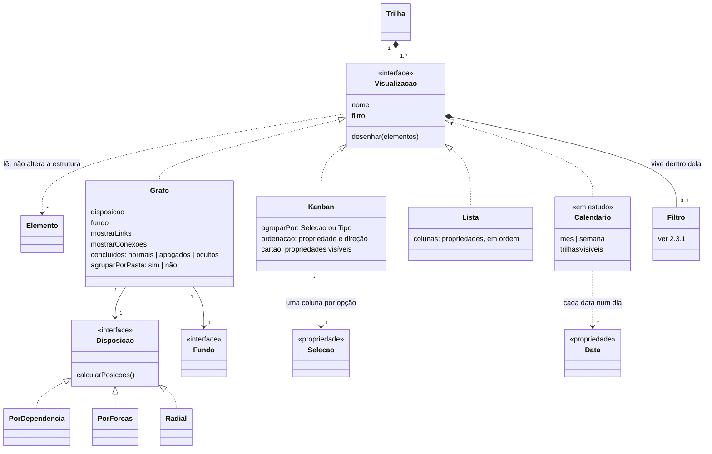

- **Grafo:** a visualização de hoje. Posições calculadas pela disposição, zoom semântico, conexões e links.
- **Kanban:** escolhe uma seleção (o estado, ou outra que o usuário criou) e mostra uma coluna por opção, na ordem e na cor das opções. Arrastar um card para outra coluna troca o valor da propriedade.
- **Lista:** uma linha por card, com as propriedades escolhidas como colunas.
- **Calendário (em estudo):** mostra os cards no dia da sua propriedade de data, em mês ou semana. Arrastar um card para um dia atribui essa data à nota, inclusive uma data futura, para marcar um compromisso ou a entrega do documento que a nota é. Como no kanban, arrastar muda o valor de uma propriedade.
- **Data é uma propriedade como as outras:** o card pode não ter nenhuma, ter uma ou ter várias, e o usuário dá o nome e o sentido de cada uma (prova, entrega, revisão). No calendário, um card com várias datas aparece em cada um desses dias, com o nome da data. Arrastar um card sem data cria uma; arrastar uma das datas de um card move só ela (proposta).
- **Data é o único jeito de pôr algo no calendário** (decidido em 07/11/2026). Uma "tarefa com data" é só um card que tem a propriedade Data: não existe prazo dentro de uma tarefa do checklist. Uma entrega ou uma lista de exercícios com dia vira um card (ou uma nota pontual) com uma Data.
- **Cada visualização é de uma trilha só.** Um kanban não junta cards de trilhas diferentes. **A exceção é o calendário** (decidido em 07/11/2026): cada trilha é um calendário, com a sua cor, como os "Meus calendários" do Google. O calendário de qualquer trilha mostra as datas de **todas** as trilhas, cada uma na cor da sua trilha, e uma lista com uma caixa por trilha liga ou desliga cada uma (`Calendario.trilhasVisiveis`).
- **Ordenação é só do kanban** (decidido em 07/11/2026): o botão Ordenar decide a ordem dos cards dentro de cada coluna, e não aparece nas outras visualizações. Nenhuma ordem é guardada à mão: soltar um card no meio de uma coluna troca só o valor, e ele vai para o lugar que a ordenação manda. A lista tem a sua própria forma de ordenar, clicando no cabeçalho de uma coluna. No grafo a posição vem da disposição, e no calendário cada dia segue a hora (os de dia inteiro primeiro).
- **Cada filtro vive dentro da visualização em que foi criado** (decidido em 07/11/2026): "só disponíveis", "só do tipo Disciplina", "esconder concluídos". Ele é salvo como parte da visualização, não é um objeto à parte, não tem nome e não é reaproveitado em outras visualizações ou trilhas. Trocar de aba troca de filtro. **Salvar como visualização** cria uma aba nova com uma cópia das regras, que daí em diante mudam separadas. Ver 2.3.1.
- O **grafo interno** de um card é uma trilha, então também pode ser visto como kanban ou lista.

#### 2.3.1 Filtros com regras

Um filtro é uma **expressão lógica** montada pelo usuário: regras sobre propriedades, combinadas com **E** e **OU**, em grupos que podem ter outros grupos dentro. A tela de Filtros mostra o caso mais simples, uma lista de regras ligadas por E:

> Estado **não é** Concluído **E** Tipo **é** Disciplina **E** Semestre **é um de** 2026/2, 2027/1

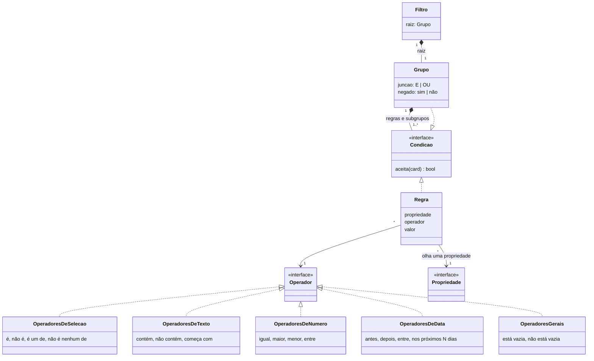

- **Cada regra olha uma propriedade** (estado, tipo, uma seleção do usuário, uma data, o progresso, as tarefas...). Os operadores que aparecem dependem do tipo da propriedade: seleção tem "é um de", data tem "nos próximos N dias", número tem "maior que".
- **Grupos dão a lógica:** um grupo junta regras com E ou com OU, e pode ser negado. Um grupo dentro de outro permite, por exemplo: Tipo é Disciplina **E** (Estado é Em andamento **OU** tem data nos próximos 7 dias).
- **Um card que não tem a propriedade** da regra conta como "está vazia". Assim, uma regra sobre Semestre esconde os cards sem semestre, a não ser que o usuário peça "está vazia".
- **Propriedade nova, operadores prontos:** cada tipo de propriedade traz os seus operadores. Uma propriedade nova entra nos filtros sem mexer no resto (o mesmo padrão modular das propriedades).
- **Filtro só esconde, nunca muda nada.** Coerente com "nada é regra, tudo é informação": a "regra" do filtro decide só o que aparece na tela.
- **No grafo, o que o filtro tira fica apagado no lugar** (decidido em 07/11/2026): o card continua no grafo, esmaecido, e a disposição não pula a cada regra nova. No kanban, na lista e no calendário, some.
- **Onde fica salvo:** junto com a sua visualização, no arquivo da trilha, em `.secondbrain/trilhas/<id da trilha>` (seção 2.5).

#### 2.3.2 Datas no padrão dos calendários (decidido em 07/11/2026)

A parte de calendário segue o **iCalendar** (RFC 5545), o padrão que o Google Calendar, o Outlook e o calendário da Apple usam. A sincronização não entra de cara (seção 6), mas cada Data já nasce com os campos de um evento, para virar um `VEVENT` sem perder nada.

| No app | No iCalendar | No Google Calendar | Observação |
|---|---|---|---|
| **Data** | `VEVENT` | evento | |
| `uid` | `UID` | `iCalUID` | Fixo, gerado na criação. É o que reconhece o mesmo evento nos dois lados. |
| `nome` · título do card | `SUMMARY` | `summary` | Exportado como "nome · card". |
| `descricao` | `DESCRIPTION` | `description` | Pode levar o caminho do card. |
| `inicio` | `DTSTART` | `start` | |
| `fim` | `DTEND` | `end` | No evento, sem fim vale a duração padrão (dia inteiro: um dia; com hora: uma hora). |
| `diaInteiro` | `DTSTART;VALUE=DATE` | `start.date` em vez de `start.dateTime` | Data sem hora é dia inteiro. |
| `fusoHorario` | `TZID` | `timeZone` | O fuso da máquina na criação (por exemplo `America/Sao_Paulo`). Dia inteiro não tem fuso. |
| `recorrencia` | `RRULE` | `recurrence` | Por exemplo, aula toda terça. No calendário do app, aparece em cada dia que a regra gera. |
| `status` | `STATUS` (`CONFIRMED`, `TENTATIVE`, `CANCELLED`) | `status` | O estado do card não vira status do evento: um card concluído só aparece com ✓ no calendário do app. |
| `ultimaModificacao` | `LAST-MODIFIED` | `updated` | Decide quem ganha num conflito. |
| `sequencia` | `SEQUENCE` | `sequence` | Sobe a cada mudança de dia ou hora. |

- **Uma Data pode ter início e fim**, para provas de duas horas ou uma semana de entrega. No calendário em semana, ocupa o horário inteiro; no mês, aparece em cada dia do intervalo.
- **Arrastar no calendário** (5.7) muda `inicio` e `fim` juntos, mantendo a duração, e sobe a `sequencia`.
- **Recorrência:** arrastar uma ocorrência pergunta se muda só aquela ou todas (proposta, como nos apps de calendário). Uma exceção vira `EXDATE` mais uma ocorrência própria (`RECURRENCE-ID`).
- **Exportar e importar `.ics`** fica possível sem nenhuma conta: o arquivo do card já tem tudo o que um `.ics` pede.

### 2.4 Como o modelo aparece no disco

Acima de tudo existe o **acervo**: um local no disco onde ficam todas as trilhas e notas. A estrutura de pastas espelha o modelo: a **trilha** é uma pasta dentro do acervo, cada **card** é uma nota, e a **pasta com o mesmo nome da nota** encapsula o grafo interno dela, com as notas internas e os arquivos relacionados.

```
Acervo/                                ← local do disco com todas as notas
  Engenharia de Computação/            ← trilha
    Cálculo I.tex                      ← card sem grafo interno
    Cálculo II.tex                     ← card com grafo interno...
    Cálculo II/                        ← ...que é esta pasta
      Limites.tex
      Derivadas parciais.tex
      Derivadas parciais/              ← grafo interno de um card interno
        exercicios-resolvidos.pdf
      Integrais duplas.md
      stewart-cap14.pdf                ← arquivo guardado na pasta
      Stewart completo.pdf  ⇢ D:\Livros\stewart.pdf   ← só o caminho: aparece aqui, mora lá
      grafico-sela.png
    Estatística.tex
    O Andar do Bêbado.pdf              ← arquivo no espaço da trilha
  Idiomas/                             ← outra trilha
```

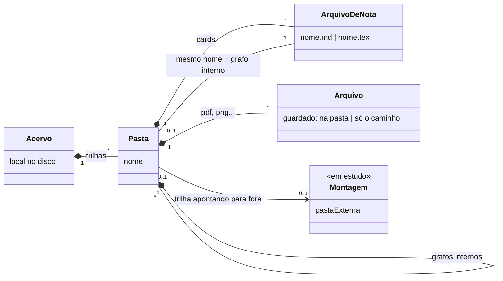

- **Trilha ↔ pasta raiz**, **Card ↔ nota**, **grafo interno ↔ pasta com o nome da nota**, **Arquivo ↔ arquivo dentro da pasta** onde ele aparece.
- Assim o acervo continua navegável fora do app, em qualquer gerenciador de arquivos, coerente com o princípio "os arquivos são seus".
- Renomear um card renomeia a nota e a pasta juntas.
- **Ao adicionar um arquivo**, o usuário escolhe: **mover** para a pasta, ou **deixar onde está** e o app guarda só o caminho. Nos dois casos o arquivo aparece como se estivesse na pasta.
- Um arquivo guardado só pelo caminho pode ser apagado ou movido por fora, e os links quebram. Isso é responsabilidade do usuário. O app só precisa mostrar o elemento como "arquivo não encontrado", em vez de sumir com ele ou dar erro.
- **Montagem (em estudo):** apontar uma pasta externa para uma trilha, como se ela estivesse dentro do acervo. Aceita qualquer pasta, mesmo fora da estrutura nota + pasta com o mesmo nome, e exibe o que conseguir: `.md` e `.tex` viram cards, arquivos conhecidos viram elementos, e o resto é ignorado.

### 2.5 Onde ficam as propriedades (decidido em 07/11/2026)

**Nada fica dentro da nota.** O `.md` e o `.tex` guardam só o texto. Tudo o que o app sabe sobre um card fica numa pasta oculta, `.secondbrain/`, na raiz do acervo, com **um arquivo por card**.

```
Acervo/
  .secondbrain/                        ← pasta oculta do app
    configuracoes                      ← as configurações do app
    tipos/                             ← os tipos de card
    selecoes/                          ← estados e outras seleções, com as opções
    trilhas/
      <id da trilha>                   ← visualizações, filtros, biblioteca, estados, tipos, seleções e preâmbulo comum da trilha
      <id da trilha>.bib               ← gerado pela Bibliografia, editável
    cards/
      <id do card>.yaml                ← um arquivo por card
    elementos/
      <id do elemento>.yaml            ← arquivo só pelo caminho, repositório, livro
    cache/                             ← PDFs compilados (vão para a pasta só ao exportar)
    calendario/                        ← sincronização com o Google Calendar
      contas                           ← quais calendários entram e saem (o token fica no cofre do sistema, não aqui)
      eventos                          ← eventos importados ainda não viraram card, recusados e o syncToken
  Engenharia de Computação/
    calculo-ii.tex                     ← só o texto; nome em slug, o título fica no arquivo do card
    calculo-ii/
```

O arquivo de um card guarda:
- o **caminho da nota** dentro do acervo (por exemplo `Engenharia de Computação/Cálculo II.tex`);
- as **propriedades**: tipo, estado, tarefas, datas, bibliografia, vídeos, relacionados e as que o usuário criar;
- as **conexões** de que ele depende (a conexão fica no arquivo do **dependente**) e os **links manuais** que saem dele;
- o **estado anterior** ao último bloqueio automático, para restaurar depois (D-41).

Por quê:
- **Um arquivo por card:** cada mudança mexe num arquivo pequeno, um erro afeta um card só, e o git ou a nuvem mostram exatamente qual card mudou.
- **Na raiz do acervo, não em cada trilha:** uma trilha montada de uma pasta externa não ganha arquivos escondidos, e os dados globais (tipos, estados, configurações) ficam juntos.
- **Por id, não pelo nome:** o arquivo do card tem um id fixo e guarda o caminho da nota. Renomear o card no app só atualiza o caminho.

Cuidados:
- **Renomear no app:** atualiza o caminho e também os links nas outras notas, sem perguntar (D-49).
- **Renomear ou mover por fora:** com o app aberto, o `WatchService` do Java percebe e atualiza o caminho. Com o app fechado, o card fica em **erro** (vermelho, tracejado); se aparecer uma nota quase igual, ele sugere religar.
- **Pasta existente:** ao abrir, o usuário escolhe converter todas as notas em cards de uma vez; se não, o arquivo do card nasce na primeira edição (D-48).
- **Formato:** YAML, com um campo `versao` para migrações (D-53).
- **Uma janela por acervo.** Se a nota aberta muda por fora, o app pergunta se recarrega (há configuração para recarregar sempre).

---

## 3. Estados do card

**O estado é informativo, nunca uma trava.** Um card Bloqueado não fica bloqueado de verdade: só avisa que o conhecimento de que ele depende ainda não foi atingido. Dá para abrir, editar e mudar o estado de qualquer card a qualquer momento.

Os estados são personalizados, e cada um pertence a uma categoria. O diagrama mostra as **categorias**. As setas cheias são o que o app **sugere sozinho** a partir das conexões e do progresso. Por cima disso, o usuário troca para qualquer estado quando quiser. Mas quando uma dependência muda, a sugestão automática passa por cima da escolha: um card **Disponível ou Em andamento** cuja dependência deixa de estar concluída volta para Bloqueado sozinho. Um card **Concluído nunca volta**, e nada passa adiante em cascata (D-40).

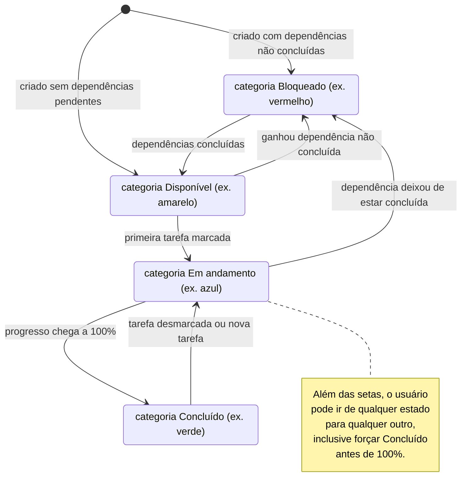

- Quando um card fica **Concluído**, os que dependem dele são reavaliados e saem de Bloqueado para o **estado que tinham antes** do bloqueio (ou Disponível, se nasceram bloqueados).
- **Quando reavaliar:** ao editar no app, ao abrir o app e quando um arquivo muda por fora.
- Um card **Bloqueado com 100% das tarefas** continua Bloqueado até as dependências serem concluídas.
- Nas mudanças automáticas, o app usa a **primeira opção** da categoria, na ordem do usuário.
- Um card **sem a propriedade Estado** não bloqueia ninguém.
- Os cards de um **grafo interno herdam** o bloqueio do card pai.
- **Erro** é um estado do sistema, não do usuário: o card fica levemente vermelho e tracejado quando a opção de estado ou o tipo dele foi apagado, ou quando o arquivo da nota sumiu. Fica assim até o usuário resolver.
- **Mover** um card para outra pasta ou trilha remove as conexões dele e religa a cadeia: os pré-requisitos passam para os dependentes.
- No **kanban**, arrastar um card para qualquer coluna sempre funciona, mesmo que ele esteja "bloqueado" ou com tarefas pendentes.

---

## 4. Sequências

### 4.1 Editar e compilar uma nota LaTeX

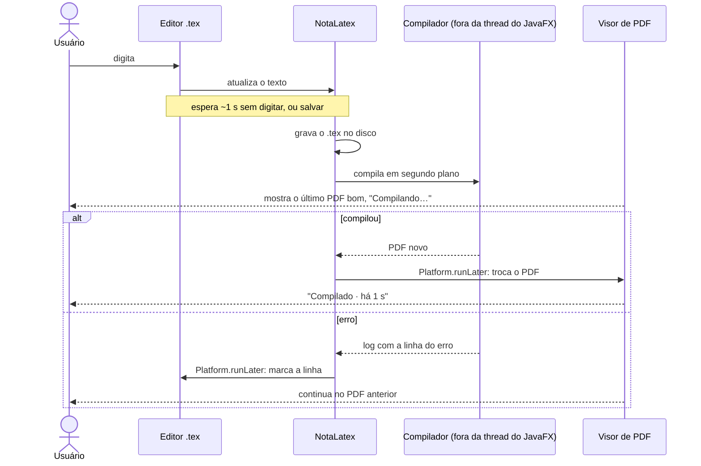

### 4.2 Compor um documento a partir de vários cards

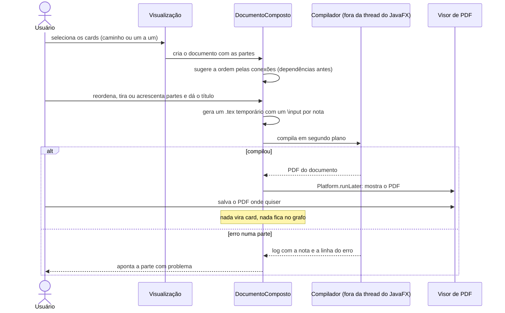

### 4.3 Link automático a partir de uma referência na nota

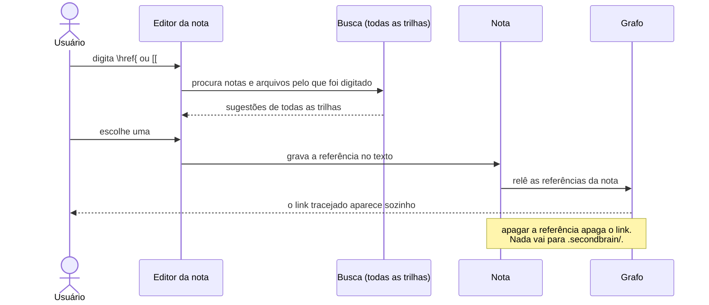

### 4.4 Arrastar um card para um dia do calendário

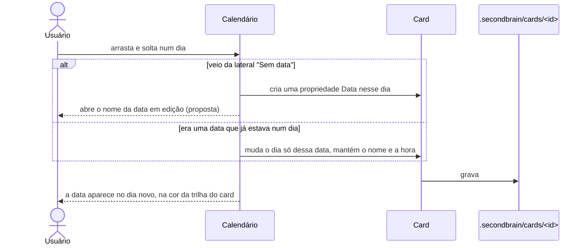

### 4.5 Editar uma nota Markdown

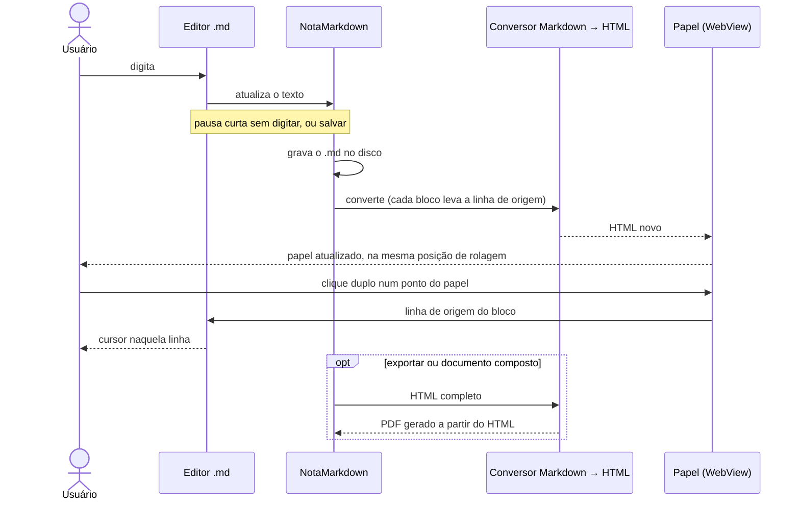

---

## 5. Funcionalidades das telas

Cada interação desenhada na página **Telas v2** do Figma e o que ela faz nos dados. O que está marcado **(proposta)** é o que a tela sugere mas ainda não foi decidido; as dúvidas maiores estão nas perguntas no fim.

Regras que valem para todas as linhas:
- **O usuário nunca move cards.** Arrastar só cria conexões, links ou muda o valor de uma propriedade. A única posição escolhida à mão é o ponto onde um card solto é criado (2.2).
- **Nada é trava.** Toda ação funciona com qualquer card, em qualquer estado.
- **Tudo o que não é texto vai para `.secondbrain/`** (seção 2.5). O texto da nota só muda quando o usuário escreve nele.

### 5.1 Início e navegação

| Interação | O que acontece | Regra |
|---|---|---|
| **Primeira abertura** | O app pede o acervo: **Criar um acervo novo** ou **Abrir uma pasta existente**. | Qualquer pasta serve; o app mostra o que conseguir ler (como na montagem, 2.4). Cria `.secondbrain/` na raiz se ainda não existir. |
| **Explorador** | Árvore com as trilhas, as pastas, os cards (na cor do estado), as notas e os arquivos, com a contagem de itens de cada pasta. Clicar abre. | Arquivo guardado só pelo caminho mostra ↗. Caminho quebrado aparece riscado em vermelho, com ⚠, e nunca some. |
| **+ no topo do explorador** | Cria um card novo na mesma pasta do card selecionado (decidido em 07/11/2026). | Sem card selecionado, cria na raiz da trilha aberta (proposta). Abre o editor de card novo. |
| **Tela inicial** (toda abertura, depois da primeira) | Uma tela no estilo da primeira abertura, com duas listas: **cards modificados recentemente** e **cards com Data perto de hoje** (decidido em 07/11/2026). Clicar num card abre a trilha dele, e a câmera voa até ele. | Recentes: a última mudança na nota ou nas propriedades do card, mais recente primeiro. Perto de hoje: Datas de hoje e dos próximos 7 dias, e as atrasadas de cards que não estão concluídos, mais cedo primeiro (proposta). Mostra cards de todas as trilhas, com a cor da trilha. Esc ou clicar fora vai para a última trilha aberta (proposta). |
| **Busca do explorador** | É a troca rápida (Ctrl Space), aberta pelo campo. | Igual à linha da troca rápida. |
| **Recolher o explorador** | Vira uma barra de ícones de 52 px; a seta do topo expande de novo. | Só muda o espaço da tela. No grafo a câmera mantém os cards em foco centralizados; na lista a última coluna estica; no kanban as colunas ganham largura. |
| **Nova trilha** | Cria a pasta da trilha na hora, como uma linha nova na árvore com o nome em edição, e abre o espaço vazio ao lado. | Sem diálogo (D-16). Esc com o nome vazio desiste e não cria nada (proposta). |
| **Troca rápida (Ctrl Space)** | Busca em todas as trilhas, em três grupos: **Cards**, **Notas e arquivos** e **Trechos** do texto das notas. ↑↓ navega, ↵ abre, Ctrl ↵ abre ao lado, Esc fecha. | Abrir um card troca para a trilha dele, se precisar, e a câmera voa até ele. Abrir um trecho abre a nota naquele ponto. |
| **Paleta de comandos (Ctrl P)** | Todas as ações do app num lugar só, com o atalho de cada uma. | Cada ação é um comando com um atalho editável (Configurações › Atalhos). |

### 5.2 Barra da trilha

| Interação | O que acontece | Regra |
|---|---|---|
| **Abas** Grafo, Kanban, Lista, Calendário | Troca a visualização da trilha aberta. | Os dados são os mesmos; cada aba tem o seu próprio filtro (2.3). |
| **+ depois das abas** | Cria uma visualização nova numa aba. | Uma aba é uma `Visualizacao` salva da trilha, com nome, tipo e filtro. Também nasce de **Salvar como visualização** no popup de filtros. |
| **Primeiro botão da direita** (o ícone muda com a aba) | Grafo: disposição e fundo. Kanban: **Agrupar por**. Lista: **Colunas**. Calendário: mês ou semana. | Fica guardado na visualização. |
| **Filtro** | Abre o popup de regras: propriedade, operador e valor; **Adicionar regra**; × tira uma regra; **Limpar** tira todas. | Ver 2.3.1. O filtro é da aba aberta. O botão fica aceso enquanto essa aba tem filtro. |
| **Ordenar** (só no kanban) | Escolhe a propriedade e a direção. | Ordena os cards dentro de cada coluna. Não aparece no grafo, na lista nem no calendário (2.3). |
| **Exibição** (olho) | Interruptores de links, conexões, notas, arquivos e agrupamento por pasta, e os concluídos normais, apagados ou ocultos. | Só muda o desenho, nunca os dados. |

### 5.3 Grafo

| Interação | O que acontece | Regra |
|---|---|---|
| **Criar um card num ponto vazio do espaço** | O card nasce ali e fica fixo; os cards em volta se afastam numa animação magnética. | Fica fixo até ganhar a primeira conexão; daí a disposição passa a arrumá-lo (2.2). Link não solta o card. Clique duplo no vazio como gesto de criar (proposta). |
| **Escolher a disposição** (por dependência, por forças, radial) | Os cards deslizam até o lugar novo e a câmera centraliza o grafo. | A posição é sempre calculada. Na radial, cada filho fica em volta do próprio pai, todas as setas têm o mesmo comprimento e nenhuma atravessa um card; um card com dois pais fica no ângulo entre eles. Quando um card se ramifica, todas as setas curvam e o pai fica centrado entre os filhos. |
| **Zoom** (roda do mouse ou − e +) | O card mostra mais ou menos conforme a distância (seção de zoom em `grafo-e-conexoes.md`). | As posições não mudam entre os níveis. Ao afastar, o card vira primeiro miniatura sem texto e, no mais longe, uma bolinha na cor do estado, com tamanho pelo peso. |
| **Hover nos níveis afastados** | Mostra o título e o progresso perto do card e destaca as suas conexões. | Só desenho. |
| **Clique num card** | Seleciona (borda) e a nota dele **espia** na borda direita do grafo: uma tira branca do papel do PDF, com a aba **<**. | No `.tex`, usa o último PDF compilado. No `.md`, o papel é o HTML da nota no WebView (4.5). Um `.tex` que nunca compilou espia com o texto puro (proposta). Clicar fora do card ou Esc tira a tira (proposta). |
| **Clique duplo no papel** | Abre o editor LaTeX no mesmo ponto do texto (5.9). | |
| **Aba < da nota espiando** | A nota abre **ao lado** do grafo, como um painel lateral com o papel. Ganha as abas **<** e **>**. | O grafo não escurece e continua usável ao lado. **<** de novo abre em **página dupla**; **>** volta um passo (página dupla → ao lado → espiando). É a sequência da D-14. |
| **Clicar noutro card com a nota aberta** | O papel troca para a nota do card novo, no mesmo tamanho (proposta). | |
| **Seta no topo do card** (expandir) | Abre o painel vertical com tudo o que o card guarda: tarefas, bibliografia, vídeos e relacionados. | Fica por cima dos vizinhos; a disposição não muda. Clicar na seta de novo recolhe. |
| **Botão maximizar** | Abre o grafo interno do card. | Só existe em card com pasta de mesmo nome (2.4). |
| **Clique duplo num card** | Abre o editor do card no lugar dele, sobre o grafo escurecido (5.7). | **Pronto** ou Esc fecha. |
| **Arrastar da alça de um card até outro** | Cria uma conexão de dependência. | Só entre cards da mesma trilha: um alvo de outra trilha, ou que não é card, não acende. Uma conexão que fecharia um ciclo é recusada. Os estados são reavaliados na hora (seção 3). |
| **Apagar uma conexão** | Selecionar a seta e Delete (proposta). | Os estados são reavaliados. |
| **Escrever uma referência na nota** | Cria o link automático (4.3). | Sugere notas e arquivos de todas as trilhas. Apagar a referência apaga o link. |
| **Buscar no grafo** | Traz os resultados (arquivos da trilha, arquivos só pelo caminho, livros da biblioteca) para perto dos cards em foco. | Não muda nada até o usuário soltar o resultado. |
| **Soltar um elemento num card** | Cria um link manual; o card de destino acende enquanto o elemento está em cima. | Guardado em `.secondbrain/cards/<id>`; não aparece no texto da nota. |
| **Soltar um arquivo de fora num card** | Cria o link manual com o card na hora, sem perguntar nada (decidido em 07/11/2026). | O arquivo entra guardado só pelo caminho, na pasta onde o card está, e dá para movê-lo para a pasta depois (proposta). |
| **Soltar um arquivo de fora no espaço** | Pergunta: **mover** para a pasta, ou **deixar onde está** e guardar só o caminho. | O arquivo entra na pasta da trilha, ou na do grafo interno aberto. Nos dois casos aparece como se estivesse na pasta (2.4). |
| **Nota fantasma: Criar card** (botão tracejado) | Cria um card no grafo interno, com uma nota própria para aprofundar a divisão. | Se o card ainda não tem pasta, ela é criada e ele ganha grafo interno. A divisão continua na nota principal. |
| **Nota fantasma: ×** | Recusa a sugestão. | A recusa fica no arquivo do card, para a fantasma não voltar; se a divisão mudar de nome, ela volta (proposta). |
| **Clicar num EPUB** | Abre o leitor do jeito da nota: espia na borda direita, a aba **<** abre ao lado, e de novo em página dupla. | O texto reflui na largura do painel. Sumário para pular de capítulo; abre na última posição de leitura. Não tem clique duplo para editor (o EPUB não é uma nota). |
| **Elemento não encontrado** | O arquivo cujo caminho quebrou aparece como "não encontrado". | Nunca é apagado sozinho; o usuário pode apontar o caminho novo ou tirar o elemento (proposta). |

### 5.4 Compor documento

| Interação | O que acontece | Regra |
|---|---|---|
| **Escolher o caminho** | Clicar nos cards em ordem, ou num card e depois noutro (o app pega o caminho de conexões entre eles). Cada card escolhido ganha um número. | Seção 4.2. |
| **Painel Compor documento** | Título, as partes em ordem (alça para reordenar, × para tirar) e três opções: **Cada nota vira um `\section`**, **Incluir notas dos grafos internos** e **Bibliografia unificada no fim**. | O resultado é só um PDF, mostrado ao lado e salvo onde o usuário quiser. Não vira card nem elemento do grafo, e nada fica em `.secondbrain/`. |

### 5.5 Kanban

| Interação | O que acontece | Regra |
|---|---|---|
| **Arrastar um card para outra coluna** | Troca o valor da propriedade agrupada. | Sempre funciona, mesmo com dependências pendentes. Para uma coluna de categoria Concluído, é o "forçar concluído"; se depois uma dependência deixar de estar concluída, a indicação automática passa por cima (seção 3). O lugar dentro da coluna vem do botão Ordenar. |
| **Coluna Sem valor** | Junta os cards sem essa propriedade. | Arrastar para ela tira o valor; arrastar dela para outra coluna dá o valor ao card. |
| **Agrupar por** | Escolhe Estado, outra seleção (Semestre, Prioridade...) ou Tipo. **Nova seleção…** cria uma seleção nas configurações. | Agrupado por Tipo, arrastar troca o tipo, que muda só nome e ícone (`cards-e-notas.md`). A faixa do card sempre mostra o estado. |
| **+ no cabeçalho da coluna** ou **Novo card** | Cria um card já com o valor da coluna e abre o editor de card novo. | O card novo vai para a raiz da trilha. |
| **··· no cabeçalho da coluna** | Edita a opção (nome, cor e, no estado, a categoria) (proposta). | Mudar a opção muda todos os cards que a usam. |
| **Cartão** | Título, ícone e tipo, a próxima data e o progresso. | As propriedades do cartão são escolhidas na visualização (`Kanban.cartao`). |

### 5.6 Lista

| Interação | O que acontece | Regra |
|---|---|---|
| **Clicar no cabeçalho** | Ordena pela coluna; clicar de novo inverte. | É a única forma de ordenar a lista (o botão Ordenar é só do kanban). Fica guardado na visualização. |
| **Colunas** | Escolhe as propriedades visíveis: alça para reordenar, olho para mostrar ou esconder, × para tirar, e adicionar. | Fica guardado na visualização (`Lista.colunas`). |
| **Célula com "—"** | O card não tem essa propriedade. | Conta como "está vazia" nos filtros. |
| **Coluna Próxima data** | Mostra a Data mais próxima a partir de hoje, com o nome. | Valor calculado, não guardado. |
| **Novo card** | Cria um card na raiz da trilha e abre o editor. | Igual ao kanban. |
| **Clique e clique duplo numa linha** | Clique seleciona; clique duplo abre o editor do card (proposta, igual ao grafo). | |

### 5.7 Calendário

| Interação | O que acontece | Regra |
|---|---|---|
| **Setas e Hoje** | Navega entre os meses (ou semanas) e volta para hoje. | |
| **Cada data num dia** | Aparece como "nome da data · card", na cor da trilha do card. Um card com várias datas aparece em cada dia. | Seção 2.3. Datas de todas as trilhas aparecem juntas. |
| **Lista de calendários** (uma caixa por trilha, com a cor) | Mostra ou esconde as datas de cada trilha. | Igual aos "Meus calendários" do Google. A cor da trilha é escolhida aqui (proposta). |
| **Data de um card concluído** | Aparece com ✓. | O ✓ vem da categoria do estado do card (proposta). |
| **Arrastar da lateral Sem data para um dia** | Cria uma propriedade Data no card, naquele dia. | O nome da data nova abre em edição na própria etiqueta (proposta). A lateral lista os cards sem nenhuma Data. |
| **Arrastar uma data para outro dia** | Move só aquela data; o nome e a hora continuam. | O card continua nos outros dias em que tem datas. |
| **Semana** | Datas sem hora ficam na faixa do dia inteiro; datas com hora ficam no horário. | Soltar num horário define a hora; soltar na faixa do dia inteiro tira a hora (proposta). |
| **Clique duplo numa data** | Abre o editor do card na seção Datas (proposta). | |
| **Evento importado do Google** | Aparece no dia como nota fantasma: translúcido, contorno tracejado, só com o título e a hora. | Seção 6. Aparece no calendário de todas as trilhas. Fica só no calendário: não entra no grafo até virar card. |
| **Fantasma de evento: Criar card** | Cria um card com uma propriedade Data ligada ao evento e abre o editor de card novo. | O card vai para a trilha do calendário aberto. A Data guarda o id do evento, então as mudanças seguem a sincronização. |
| **Fantasma de evento: ×** | Recusa o evento. | A recusa fica em `.secondbrain/calendario/eventos`; o evento não volta, mesmo se mudar no Google. |

### 5.8 Editor do card

| Interação | O que acontece | Regra |
|---|---|---|
| **Título** | Edita o título do card. | Renomeia a nota e a pasta juntas (2.4). |
| **Abrir nota** | Abre o `.tex` ou o `.md` do card. | |
| **Tipo, Estado e seleções** (Semestre...) | Cada chip abre as opções. | Trocar o tipo muda só nome e ícone. O estado escolhido vale até uma dependência mudar (seção 3). |
| **Tarefas** | Alça reordena, a caixa marca, o texto edita no lugar, × remove, **+ Adicionar tarefa**. | Marcar ou desmarcar recalcula o progresso, que pode mudar o estado (seção 3). A ordem das tarefas é do card. |
| **Datas** | Cada data tem nome, dia e hora opcional; **Adicionar data**. | Seção 2.3. |
| **Bibliografia** | ★ marca principal ou complementar; a busca procura na biblioteca e online por título, autor, ISBN ou DOI; o que já está no card aparece como "Já na lista". | Um livro novo entra na biblioteca da trilha de fora e depois no card. |
| **Vídeos** | Colar o link do YouTube traz miniatura, título e duração. | |
| **Relacionados** | **Vincular nota, livro ou repositório.** | Vincular cria um link manual (2.2). |
| **Adicionar propriedade** | Escolhe o tipo de propriedade e o nome. | Vale só para esse card. |
| **Excluir card** | Manda tudo para a lixeira do sistema: a nota, a pasta do grafo interno (com o que tem dentro) e o arquivo do card em `.secondbrain/` (decidido em 07/11/2026). | Pede confirmação antes (proposta). Como vai para a lixeira, dá para recuperar por lá. As conexões e os links que apontavam para o card somem junto. |
| **Pronto ou Esc** | Fecha o editor. | Cada mudança é gravada na hora em `.secondbrain/cards/<id>` (proposta). |

### 5.9 Notas, LaTeX e bibliografia

| Interação | O que acontece | Regra |
|---|---|---|
| **Digitar no `.tex`** | ~1 s depois de parar de digitar, grava e compila fora da thread do JavaFX; o visor fica no último PDF bom com "Compilando…". | Seção 4.1. |
| **Clique duplo num ponto do PDF** | Abre o editor LaTeX já posicionado no trecho do `.tex` que gerou aquele ponto, com o cursor na linha. | Vale no PDF espiando, ao lado, em página dupla e no documento composto (aí abre a nota da parte certa). Usa o SyncTeX gerado na compilação. Sem SyncTeX (compilação antiga ou com erro), abre a nota no começo. |
| **Digitar no `.md`** | O editor fica à esquerda e o papel à direita. A cada pausa, o Markdown vira HTML e o WebView mostra o papel atualizado, sem compilar nada. | Seção 4.5. Fórmulas `$…$` e `$$…$$` são desenhadas no HTML (proposta: KaTeX). Uma referência `[[…]]` vira link, como em 4.3. |
| **Clique duplo no papel do `.md`** | Abre o editor do `.md` no bloco (parágrafo, título, item) que gerou aquele ponto. | Cada bloco do HTML guarda a linha do `.md` de onde veio. Funciona no papel do WebView. No PDF exportado, não (proposta). |
| **Gerar o PDF de um `.md`** | O PDF sai do mesmo HTML do papel, com o mesmo visual. | Só quando precisa de um arquivo: exportar, imprimir ou entrar num documento composto. Na tela o `.md` sempre mostra o HTML. |
| **Erro de compilação** | Marca a linha no editor, mostra o log resumido embaixo e mantém o PDF anterior. | Nada trava a edição. |
| **Biblioteca da trilha** | Busca e adiciona livros (na biblioteca e online). | Uma biblioteca só, na trilha de fora; os grafos internos usam a mesma. |

### 5.10 Configurações

| Aba | O que tem | Regra |
|---|---|---|
| **Geral** | Pasta do acervo, formato e autor padrão das notas novas, e a lista de propriedades órfãs para religar. | Religar é escolher a nota certa; as órfãs nunca são apagadas sozinhas. |
| **Tipos de card** | Nome, ícone e propriedades iniciais. | Editar um tipo vale só para cards novos. |
| **Estados e seleções** | Estados com nome, cor (RGB ou hex) e categoria; outras seleções com as suas opções. | As indicações automáticas olham a categoria. |
| **LaTeX** | Tectonic embutido ou o TeX da máquina; compilação automática com espera ajustável. | |
| **Visualização padrão** | Trilha nova abre em grafo, kanban, lista ou calendário; disposição, fundo, mostrar links, mostrar conexões e concluídos (normais, apagados, ocultos). | Cada trilha pode mudar depois. |
| **Calendário** | Conectar a conta do Google, escolher quais calendários do Google são importados, e ligar ou desligar a sincronização. | Seção 6. Cada trilha exporta para um calendário do Google com o seu nome e cor. |
| **Aparência** | Só o tema escuro por enquanto. | |
| **Atalhos** | Todos editáveis: clicar numa tecla grava a combinação nova. | Conflitos aparecem marcados. |

---

## 6. Sincronização com o Google Calendar (futuro, opcional)

> **Não entra na primeira versão** (decidido em 07/11/2026). O que entra já é o modelo de datas da seção 2.3.2, que torna esta sincronização possível depois sem mudar os dados. As regras abaixo são o plano para quando ela vier.

As datas dos cards vão para o Google Calendar, e os eventos do Google Calendar entram no app como **notas fantasmas**, para o usuário transformar em cards e aprofundar.

### 6.1 Regras

- **Saída (app → Google):** cada **Data** de card vira um evento, com os campos da tabela em 2.3.2. **Cada trilha vira um calendário próprio no Google**, com o nome e a cor da trilha, e os eventos de um card vão para o calendário da trilha dele. O id do evento fica na Data, em `.secondbrain/cards/<id>`.
- **Entrada (Google → app):** os eventos dos calendários escolhidos entram como **EventoImportado**, uma nota fantasma que mora no calendário. Nada vira card sozinho: **Criar card** transforma, **×** recusa.
- **Evento que já veio do app** não volta como fantasma: o app reconhece o id e só atualiza a Data.
- **Mudou no app:** a data muda no Google na próxima sincronização.
- **Mudou no Google** um evento ligado a uma Data: a Data muda no app (decidido em 07/11/2026). A sincronização vale nas duas direções.
- **Os dois mudaram** desde a última sincronização: vale a mudança mais recente, e o app avisa no próprio evento (proposta).
- **Apagou no app:** o evento é apagado no Google.
- **Apagou no Google:** a Data **não** é apagada. Ela perde a ligação e fica marcada "removida do Google", porque o app nunca apaga dado do usuário sozinho. O usuário decide se apaga ou se manda de novo.
- **Sem internet:** tudo continua funcionando; a sincronização roda quando a conexão volta, em segundo plano, fora da thread do JavaFX.
- **Nada é regra:** um card ligado a um evento continua editável como qualquer outro, e as datas sem ligação funcionam do mesmo jeito.

### 6.2 Sequência

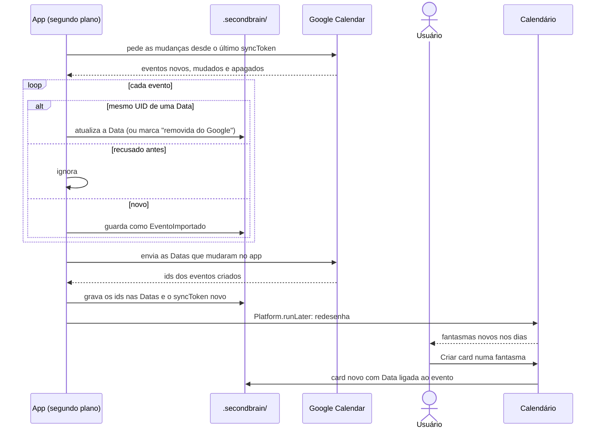

---

## Perguntas que a modelagem levantou

Nenhuma pergunta aberta no momento.

